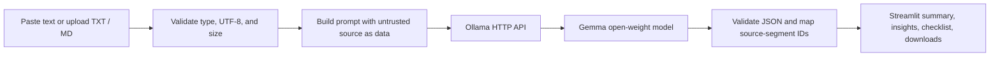

# LazyBrief

**Less reading busywork. More time for what matters.**

LazyBrief turns long notes and text documents into a concise summary, evidence-backed key insights, and a practical action checklist. It uses an open-weight Gemma model through Ollama; inference is not mocked and no paid AI API key is required.

> **Privacy:** By default, text is sent to the Ollama service on your own computer at `http://localhost:11434/api/generate`. LazyBrief does not log document contents or save uploads. If you change the endpoint to a non-local host, the app warns you and requires you to confirm that host before sending text. Ollama's behavior on a separately configured server is outside LazyBrief's control. This app has not been verified to be fully offline.

## Why LazyBrief?

Rereading meeting notes, study material, and technical documents takes attention away from the next useful task. LazyBrief creates a compact, source-checkable starting point without sending text to a hosted AI provider by default.

## Features

- Summaries in short, medium, or detailed formats.
- Input word and character counts.
- Separate key insights labelled as source-based facts or AI interpretations.
- Source-based insights cite exact original text through numbered source segments.
- Checklist entries show original source sentences selected from explicit task and commitment cues; LazyBrief does not rewrite them or add owners and deadlines.
- UTF-8 `.txt` and `.md` uploads, limited to 1 MiB and 50,000 characters.
- Fictional sample meeting notes for an immediate test.
- Independent downloads for the summary, insights, action items, and complete Markdown brief.
- Ollama/model availability checks and actionable connection, missing-model, timeout, and response errors.
- A confirmation gate before sending text to a configured non-local endpoint.

LazyBrief cannot guarantee that a model's summary is complete or correct. Always check the source before relying on a generated brief.

## Architecture and request flow



The app keeps input and results in the current Streamlit session. It does not create a document database, persist uploads, call tools, or execute document instructions. The prompt asks the model to treat the source as untrusted data; this is a mitigation, not a guarantee that a model can never be influenced by hostile text.

## Technology

- Python 3.10+
- Streamlit
- Ollama local inference API
- `gemma3:1b` by default
- `requests`
- `pytest`

## Install on Windows

Open PowerShell in the project folder:

```powershell
cd "$HOME\Downloads\Hacktoberfest\LazyBrief"
.\.venv\Scripts\Activate.ps1
python --version
python -m pip install -r requirements.txt
```

The project uses the existing `.venv`; do not recreate it if it is already present. If PowerShell blocks activation, you can use the virtual environment's interpreter directly instead:

```powershell
.\.venv\Scripts\python.exe -m pip install -r requirements.txt
```

## Install Ollama and Gemma

1. Install Ollama for Windows from [ollama.com/download](https://ollama.com/download).
2. In PowerShell, download the default model:

   ```powershell
   ollama pull gemma3:1b
   ```

3. Check that Ollama lists the model:

   ```powershell
   ollama list
   ```

4. Keep Ollama running. The app checks the configured endpoint and model before it sends a generation request.

If Ollama is not running, launch the Ollama desktop app or run `ollama serve` in a terminal. If the model is missing, run `ollama pull gemma3:1b`. You can choose another model in the sidebar if it is installed and compatible with Ollama's `/api/generate` endpoint.

## Configure and launch

Optional environment variables:

| Variable | Default | Purpose |
| --- | --- | --- |
| `LAZYBRIEF_OLLAMA_URL` | `http://localhost:11434/api/generate` | Ollama generate endpoint |
| `LAZYBRIEF_MODEL` | `gemma3:1b` | Installed Ollama model name |
| `LAZYBRIEF_TIMEOUT` | `180` | Request timeout in seconds (1–900) |

In PowerShell, set a variable for the current terminal session before launch if needed:

```powershell
$env:LAZYBRIEF_MODEL = "gemma3:1b"
$env:LAZYBRIEF_TIMEOUT = "180"
```

Run the app from the project folder:

```powershell
python -m streamlit run app.py
```

Open the local URL Streamlit prints in the terminal (normally `http://localhost:8501`).

## Example

1. Select **Load fictional sample notes** or paste notes into the source panel.
2. Choose a summary length.
3. Select **Generate my brief**.
4. Review the evidence quotes and generated checklist against the source.
5. Download one section or the complete Markdown brief.

The sample is fictional. Generated output depends on the model installed locally; no sample output is presented as a real inference result.

## Privacy and safety

- The default request goes to localhost; LazyBrief does not silently redirect text to a third-party AI provider.
- The configured endpoint is visible in the sidebar. A non-local endpoint requires typing a confirmation that names its host.
- Input and output are kept in Streamlit's in-memory session state and are not written to project files or logged by LazyBrief.
- Uploaded content is decoded and validated in memory. It is not persisted.
- File types are limited to UTF-8 plain text and Markdown. PDF, DOCX, and other formats are not supported.
- The prompt treats document content as untrusted and instructs the model not to follow embedded instructions. A prompt is not a security boundary; the app has no tools or execution capability.
- A remote Ollama endpoint can receive the document, and that server's operator may retain it. Use localhost for local processing.
- Do not submit confidential documents unless you understand the endpoint's data handling.

## Limitations

- A small model can miss context, misstate a point, or omit an action; exact source references help verification but do not prove that a summary is accurate.
- Action detection uses explicit language cues, so an implicit task can be missed; generated insight citations identify the referenced sentence but cannot prove the interpretation is correct.
- LazyBrief does not assign owners or deadlines that the source does not state.
- Large or complex documents may exceed the configured text limit or the model's practical context.
- No time-saving amount has been measured; the intended benefit is less rereading, not a quantified productivity claim.
- No hosted demo or mobile-specific testing has been performed.

## Tests

The suite covers input and upload validation, prompt construction, response parsing and grounding, endpoint checks, mocked HTTP failures, and model availability:

```powershell
python -m pytest -q
python -m compileall -q app.py src tests
```

Unit tests mock HTTP. They do not substitute for testing a real local model, and model output is not deterministic.

## Screenshots

Add genuine screenshots from the running app to [`screenshots/`](./screenshots/README.md) before publishing. Do not use mockups as if they were captured app output, and remove any private source text from screenshots.

## Hacktoberfest Week 3

LazyBrief is intended to address the **Slow and Steady** prompt by using local open-weight inference to reduce note rereading. The project was created in this folder on October 25, 2026, within the entry period shown on the [official challenge page](https://dev.to/challenges/hacktoberfest-week3-2026-10-19). The official deadline is October 25 at 11:59 PM PDT (October 26 at 06:59 UTC). Entry eligibility is determined by the organizer; building a project or saving a DEV draft does not guarantee that an entry qualifies.

Gemma is the application's core model, so a Best Use of Gemma category entry may be relevant if the current category rules accept this use. No GitHub Copilot prize category is claimed: ordinary AI-assisted development alone is not evidence that the project meets that category's requirements.

The required submission tag is `hf26challenge`; the requested companion tag is `devchallenge`. Before entering, publish a DEV post using the official template, add the code link, and include a real demo link or video. No repository, demo, or video URL is claimed in this repository.

## License

This project is provided under the MIT License. Copyright notice: `LazyBrief contributors`; no individual copyright holder is asserted.

## Possible next steps

- Add optional document chunking for longer inputs.
- Evaluate summary faithfulness across a curated, consent-safe test set.
- Add accessible user-controlled export options and real-world usability testing.
- Capture a genuine, privacy-safe app screenshot and record a real demo.
